# 1U CubeSat Prototype for Earth Observation

A student-built **1U CubeSat** (10 × 10 × 10 cm) prototype, made as our graduation project in
Electronics and Communications Engineering (High Institute of Engineering and Technology, King Mariout, Egypt, 2023).

We designed and built a working ground model: four subsystem PCBs stacked inside a 1U frame,
an ESP32 on-board computer, environmental sensors, and solar power with a Li-ion battery.

<p align="center">
  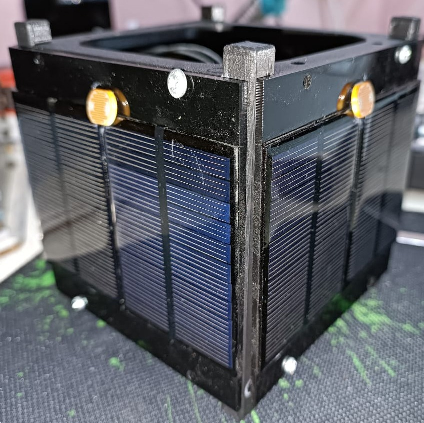
  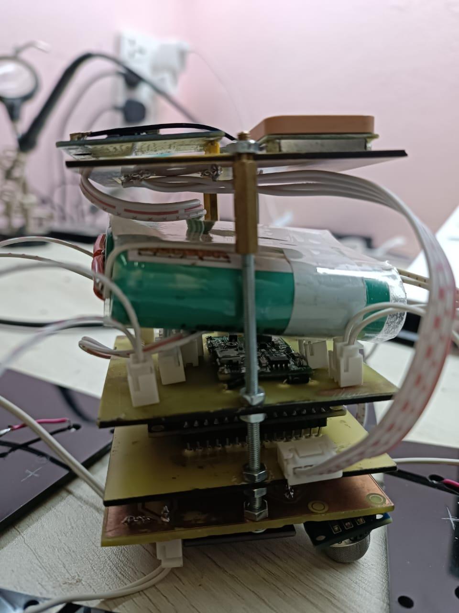
</p>

> **Team project.** Built by a team of 11 students under the supervision of Dr. Samar Farghaly.

## Mission (prototype goals)

- Take images of the Earth with an on-board camera
- Measure temperature, humidity, UV level and gas (CO) values
- Know its orientation (gyroscope + accelerometer) and position (GPS)
- Find the sun direction with 4 light sensors
- Charge itself with solar panels

## System overview

| Subsystem | What it does | Main parts |
|---|---|---|
| **OBC** (On-Board Computer) | Reads all sensors, runs the code | ESP32 dev board |
| **Payload** | Camera and environment sensors | ESP32-CAM, DHT11 (temp/humidity), GUVA-S12SD (UV), MQ-9 (gas) |
| **ADCS** (Attitude Determination) | Orientation and position | MPU-6050 (gyro + accelerometer), NEO-6M GPS, 4 × LDR sun sensors |
| **EPS** (Electrical Power) | Power generation, storage, distribution | 70 × 50 mm 5 V solar panels, 18650 Li-ion battery, step-up converter |
| **Structure** | Holds everything | 3D-printed 1U frame |

Each subsystem has its own PCB. We designed the schematics and PCBs in EasyEDA,
tested every part on a breadboard first, then made the boards by etching.

## Hardware

| PCB | Schematic |
|---|---|
| 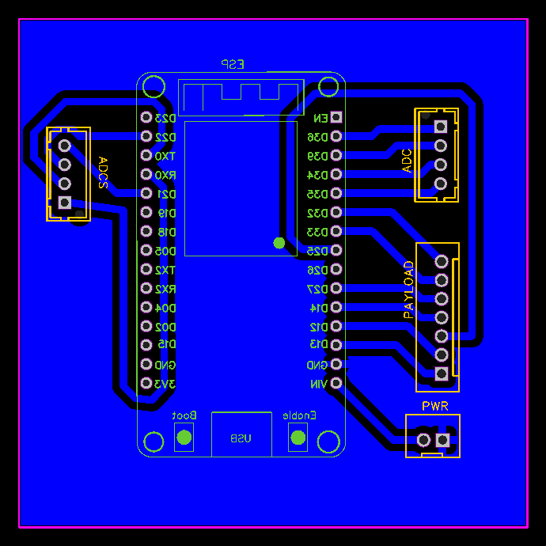 | [OBC schematic](images/schematics/obc.png) |
| 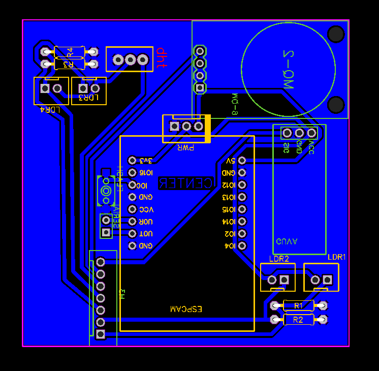 | [Payload schematic](images/schematics/payload.png) |
| 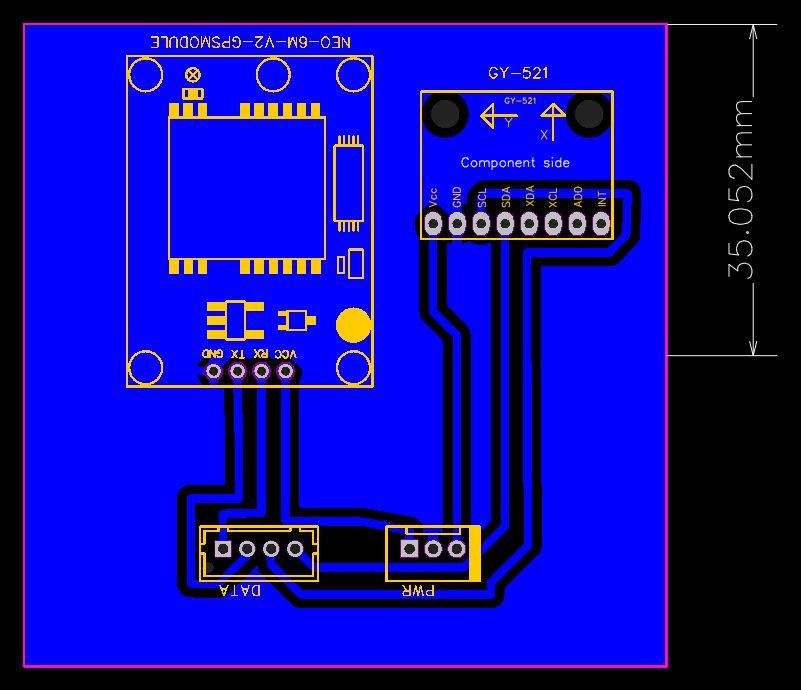 | [ADCS schematic](images/schematics/adcs.png) |
| 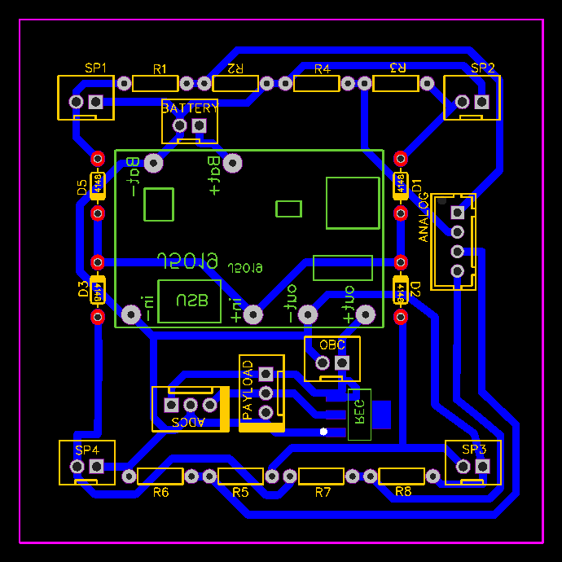 | [EPS schematic](images/schematics/eps.png) |

Full system schematic: [all-subsystems.png](images/schematics/all-subsystems.png)  
3D model of the EPS board: [hardware/3d-model](hardware/3d-model/)

## Build photos

All 21 photos are in [`images/photos/`](images/photos/).

| | | |
|---|---|---|
| 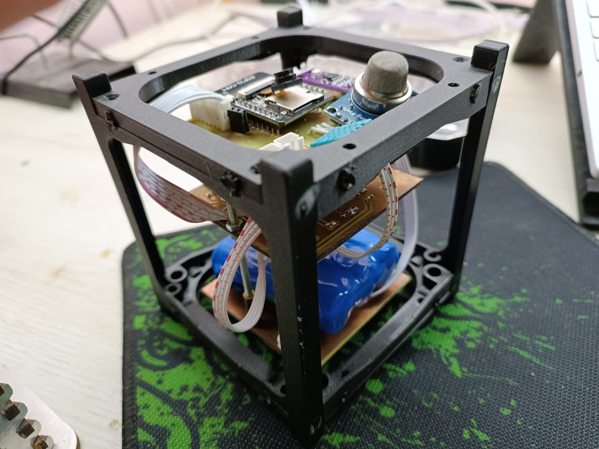 | 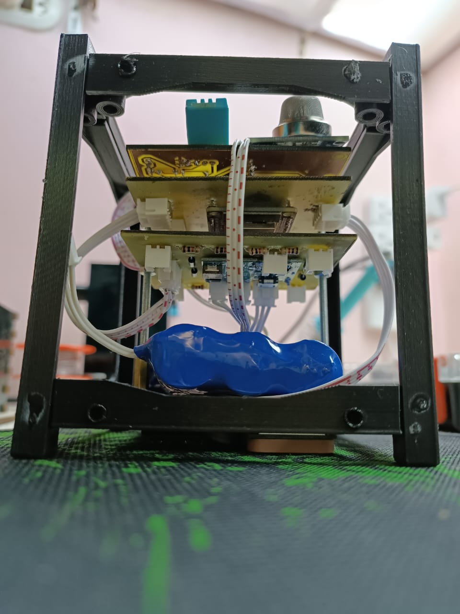 | 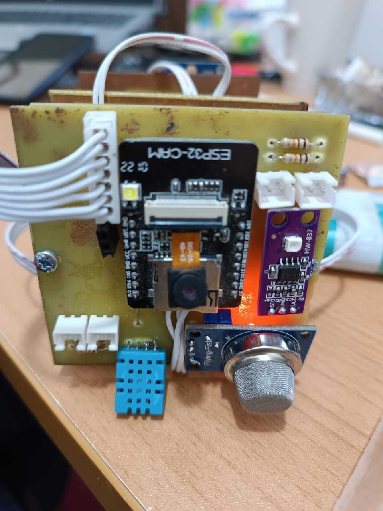 |
| Assembled CubeSat | Boards inside the frame | Payload board (ESP32-CAM, DHT11, MQ-9, UV) |
| 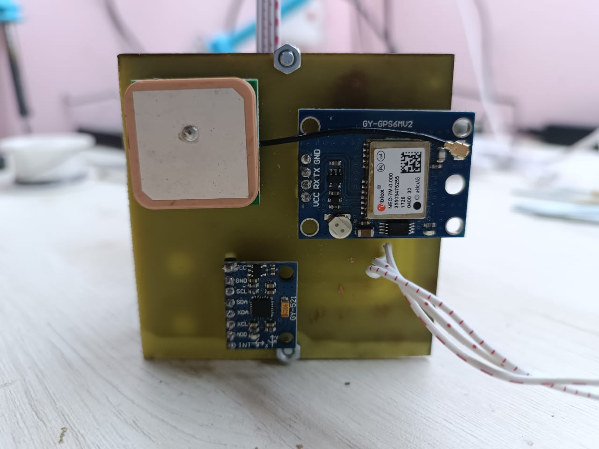 | 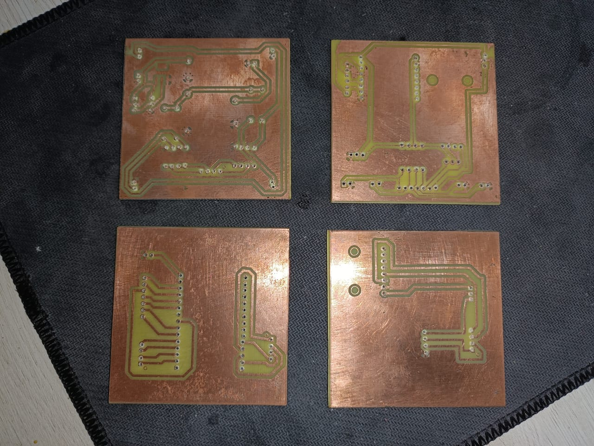 | 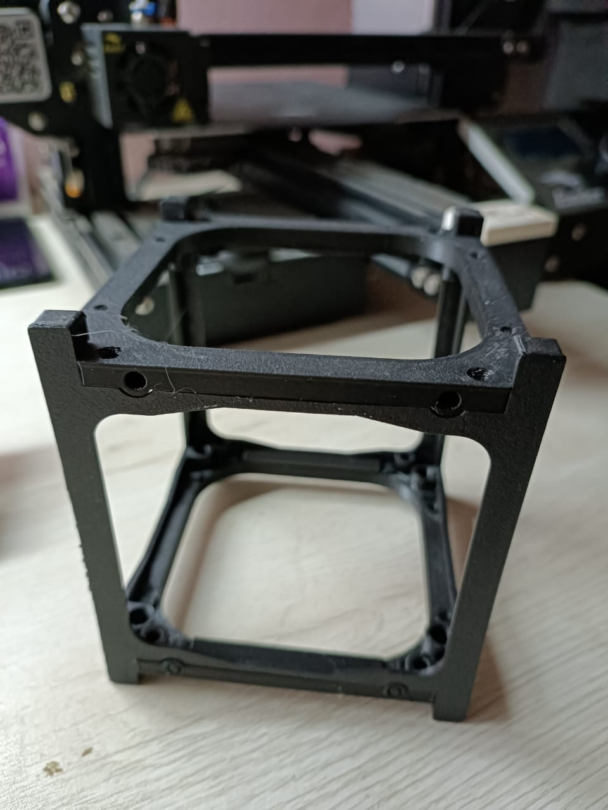 |
| ADCS board (GPS + gyro) | Etched PCBs | 3D-printed 1U frame |

## Software

| Folder | What is inside |
|---|---|
| [`firmware/cubesat_obc/`](firmware/cubesat_obc/) | **Cleaned-up ESP32 code (2026).** Reads all sensors every 2 s without blocking, prints a report on the Serial Monitor, and runs a Wi-Fi web server (`/` = live page, `/data` = CSV values). |
| [`firmware/original_2023/`](firmware/original_2023/) | The original 2023 test code from the project book, kept as it was (only the Wi-Fi password removed). It prints sensor values on the Serial Monitor. |
| [`ground-station-web/`](ground-station-web/) | The original ground station web page. It asks the ESP32 for new readings every 2 seconds and shows them. |

**What changed in the cleaned-up code:** GPS moved to its own UART (Serial2), no more `delay()` or
`while(true)` in the loop, the Wi-Fi web server that the page needs was added, gyroscope values converted
to °/s, and the Wi-Fi details moved to a `secrets.h` file that is not uploaded.

**How to run it**
1. Install the Arduino IDE with the ESP32 board package.
2. Install the libraries: *DHT sensor library*, *TinyGPSPlus*, *Adafruit MPU6050*, *Adafruit Unified Sensor*.
3. Copy `secrets.example.h` to `secrets.h` and write your Wi-Fi name and password.
4. Upload to the ESP32, open the Serial Monitor (115200), then open the IP address it prints.

### Pin map (ESP32)

| Signal | GPIO |
|---|---|
| DHT11 data | 25 |
| MQ-9 gas (analog) | 12 |
| GUVA-S12SD UV (analog) | 13 |
| LDR sun sensors 1–4 | 32, 33, 27, 14 |
| ADC side channels 1–4 | 36, 39, 34, 35 |
| MPU-6050 | I2C (default SDA 21 / SCL 22) |
| GPS (cleaned code) | RX2 = 16, TX2 = 17 |

## Presentation

Our final project presentation: [docs/CubeSat-1U-Presentation.pdf](docs/CubeSat-1U-Presentation.pdf)

## Repository structure

```
firmware/
  cubesat_obc/          cleaned-up ESP32 code + secrets.example.h
  original_2023/        original code from the project book
ground-station-web/     web page that shows live readings
images/
  photos/               build and test photos
  pcb/                  PCB layouts (EasyEDA)
  schematics/           schematics (EasyEDA)
hardware/3d-model/      3D model of the EPS PCB (OBJ)
docs/                   final presentation (PDF)
```

## What I learned

- Splitting a satellite into subsystems (OBC, Payload, ADCS, EPS) and defining the connections between them
- Schematic capture and PCB layout, then making and soldering real boards
- Reading digital, analog, I2C and UART (GPS) sensors on the ESP32
- Testing on a breadboard before moving to PCBs

## Next version (Rev 2) plans

The prototype worked well on the bench. For a second hardware revision I would:

- Run all sensor signals at 3.3 V logic to match the ESP32 directly
- Move analog sensors to ADC1 pins (GPIO 32–39) and keep boot pins (like GPIO 12) free
- Give the GPS its own UART (UART2), separate from the USB port
- Add filter capacitors on the 3.3 V regulator
- Use FreeRTOS tasks for sensors, GPS and the web server
- Add a radio link (for example LoRa) for a real ground station
- Add battery voltage monitoring and power modes in the EPS
